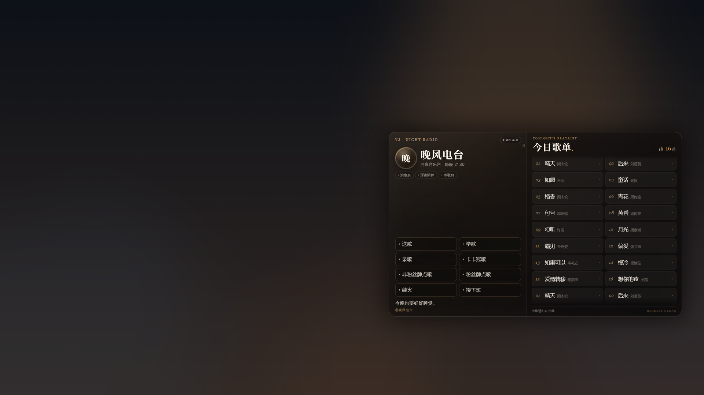
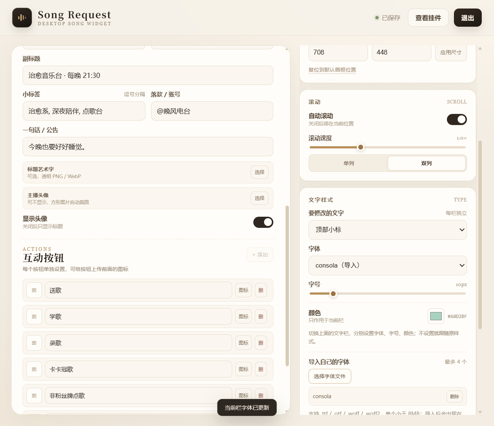
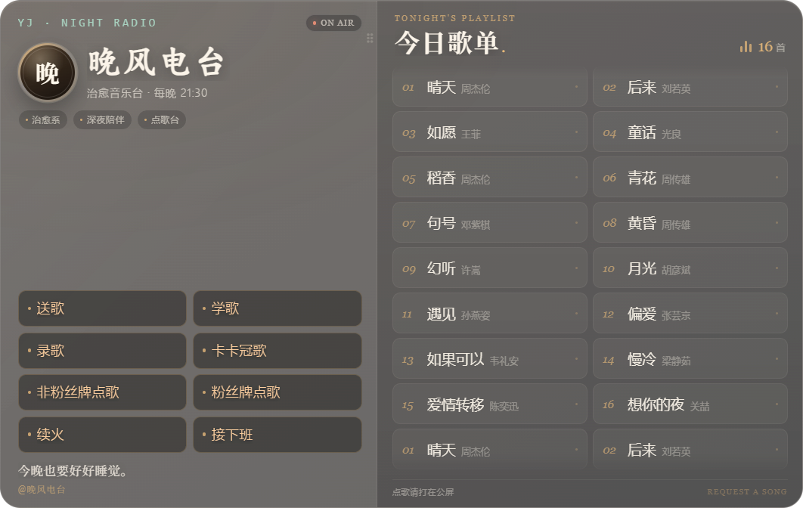
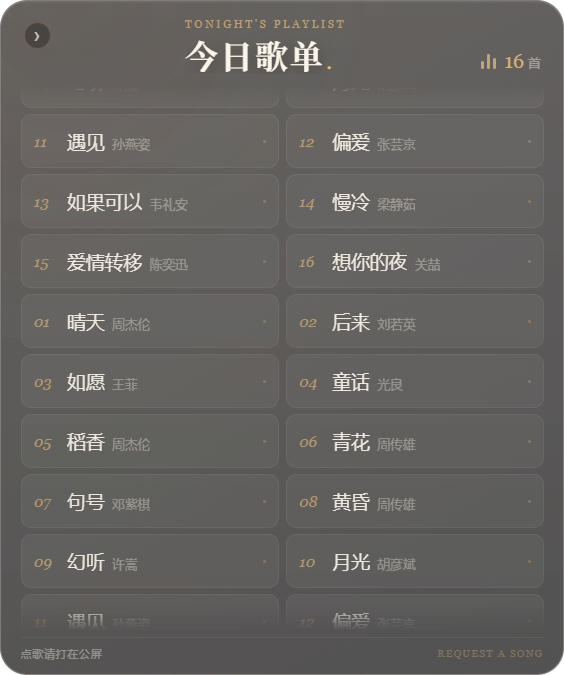

# Song Request · Windows 桌面点歌台

一个面向直播/桌面场景的 Windows 透明点歌台挂件。不是网页，也不是全屏页面：它以一个可拖动、可缩放的透明窗口停留在桌面上，设置窗口负责编辑内容。



## 功能

- 左栏：顶部小标、头像（可隐藏）、标题艺术字、副标题、标签、互动按钮、公告/落款
- 右栏：自动滚动歌单，每行可选 1–6 首，速度可调
- 歌单编辑支持搜索定位：输入歌名/歌手，点结果直接跳到对应歌词行
- 左侧电台信息可一键收起/展开：收起后窗口缩到歌单宽度，只保留歌单
- 标题艺术字可上传透明 PNG/WebP，最大高度 106px，显示在副标题上方
- 互动按钮逐个配置文字和图标，2×4 布局
- 每栏独立设置字体、字号、颜色；支持 Windows 已安装字体、导入自己的 `.ttf/.otf/.woff/.woff2`
- 卡片浓度 0–90%，卡片、歌单行和按钮同步
- 透明背景；可选照片背景、头像、标题图
- 允许拖动 / 锁定位置、锁定宽高比例、始终置顶、鼠标穿透
- 托盘、`Ctrl+Alt+O` 显示/隐藏





### 收起状态

点击左栏右上角的箭头收起电台信息，只保留歌单；再点歌单左上角的箭头展开。



## 开发

需要 Windows 10/11 x64、Node.js 20+。

```powershell
cd desktop
npm install
npm start
```

## 打包

```powershell
cd desktop
npm run package
```

产物输出到 `desktop/dist/Song Request-win32-x64/`。  
Electron 首次安装/打包可能需要可访问的 Electron 下载源；国内可设置 `ELECTRON_MIRROR`。

## 结构

```text
desktop/
  main.js              Electron 主进程：窗口、托盘、快捷键、状态保存
  preload.js           安全 IPC 桥
  app/settings.html    设置窗口
  app/widget.html      桌面透明挂件
  assets/              应用图标与托盘图标
docs/                  README 截图
```

## 说明

- 设置保存在本机 `%APPDATA%\Song Request\settings.json`
- 不联网、不上传内容
- 应用未签名；Windows SmartScreen 可能提示，需要选择“更多信息 → 仍要运行”
- 仓库只包含源码；Windows 免安装包建议放在 GitHub Releases，而不是提交进 Git

## Contributing

欢迎提交 Issue 和 Pull Request。开发、分支和提交说明见 [CONTRIBUTING.md](CONTRIBUTING.md)。

## License

Copyright 2026 Chenxi-Only-Y.

本项目使用 **Apache License 2.0**，可自由使用、修改、分发和商用，但需要保留许可证与版权声明，并注明修改过的文件。完整条款见 [LICENSE](LICENSE)，归属说明见 [NOTICE](NOTICE)。

> 注意：Apache-2.0 是开源许可证，不是 Windows 代码签名证书；它不会消除 SmartScreen 的“未知发布者”提示。
